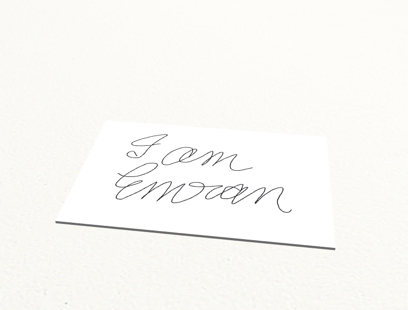

# skill-to-bot

Draw once. A simulated Franka Panda reproduces your strokes with an attached pen.

Your handwriting is the starting point, not a preset. The robot follows the strokes you recorded and can repeat the same drawing on shifted paper without another demonstration. You can watch the actual simulation and compare the pen's measured path with your original lines.

Original pen, touch or mouse input is preserved as immutable JSON and converted into a robot-independent DRAW skill. A hand-coded controller follows paper-local pen-tip targets in robosuite/MuJoCo. This is trajectory retargeting, not a trained policy: no handwriting recognition, vision model, RL, world model or LIBERO task is involved.

## Run
Start Docker Desktop with Linux containers. Use Bash, or Git Bash on Windows:

```bash
bash build-and-run.sh
```

Open [localhost:5173](http://localhost:5173). Choose **New drawing**, draw, then **Save & Run**. Color and brush size apply to new strokes. Undo and Clear edit unsaved input. Home shows completed human captures; a fresh installation starts empty. **Watch a run** opens an existing recording without executing the robot.

Results include native simulator video, measured errors and inline Logs, Raw Input, Skill and Trace. Playback at 1x/2x/5x/10x changes only the player. **Run on shifted paper** reuses the exact skill at a modest second pose. History deletion hides a finished run but preserves its demonstration, artifacts and request-ID deduplication.

`bash run.sh`, `bash stop.sh` and `bash clean.sh` manage only this project and preserve local demonstrations, outputs and settings. Ports bind to localhost; internet-facing deployment requires authentication and TLS.

## Personal Data and Reproduction
The owner approved the three original captures in [the evidence manifest](evidence/manifest.json) for public submission: one mouse drawing and two touch drawings, with 1,526, 600 and 358 samples respectively. They were drawn directly in the browser, not generated or recognized. Raw bytes, stroke boundaries, relative timestamps and device metadata are preserved with SHA-256 checksums. The original device models and collection dates were not recorded; these are not egocentric videos or calibrated force measurements.

Reproduce the comparison without private data, a GPU or a running app:

```bash
bash src/scripts/evaluate.sh
```

The command builds the existing service images, extracts each skill once and executes 18 cases: three human captures, three paper poses and two methods. The baseline disables only lead/integral tracking compensation; both methods retain the same OSC, path-advancement feedback, geometry, speeds and acceptance limits. Numerical-library thread counts are fixed at one for both methods. All outcomes, including baseline failures and partial recordings, are retained. The command fails if a compensated case misses acceptance or artifact integrity checks fail.

Each invocation creates a new ignored `data/exports/build-04-<UTC timestamp>/` directory. `results.json` records every case, input/skill/code hashes, exact settings, runtime versions and artifact checksums. Each case retains its plan, measured trace, metrics, native PNG and MP4. Runs are serial in isolated containers and do not alter app history. Partial results are never silently resumed or overwritten.

The reference comparison took about 100 minutes on this CPU host, mostly in the deliberately slow baseline. The included recordings and report can be inspected without rerunning it.

Six generated fixtures under `tests/fixtures/drawings/` are regression tests, not personally collected challenge evidence.

## Measured Results
The [complete 18-case report](evidence/results.json) records 9/9 compensated successes and 3/9 baseline successes. The other six baseline cases exceeded the unchanged 540-second wall deadline; partial paths and missing completed-stroke metrics remain explicit. Those failures describe this host's execution budget, not geometrically unreachable poses. For the mouse default-pose pair, task duration was 58.2 versus 341.8 simulated seconds. This is simulated execution time, not policy-inference latency; wall timing depends on the host and workload.

The compensated method passed all nine drawing/pose cases. Per-run mean tracking error was 0.346-0.351 mm; the worst measured tracking error was 0.687 mm and worst per-stroke bidirectional shape error was 0.535 mm. Simulated task durations were 58.2-129.0 seconds. These are three original drawings at three predefined poses, not nine independent people or a learned generalization benchmark.

Geometric paper proximity was 100%, but actual MuJoCo physical-contact coverage was only 34.7-41.7%. The proximity-based ink model does not establish continuous physical contact or force control. Compensation improves the measured trajectory-following workflow; it is not a trained-policy or inference-speed result.



- Mouse capture: [input](evidence/demonstrations/2fb0a84d02e743efba4ced091537732c.json), [native result](evidence/examples/mouse-01/compensated/simulator-final.png), [recording](evidence/examples/mouse-01/compensated/simulation.mp4), [completed baseline recording](evidence/examples/mouse-01/uncompensated/simulation.mp4).
- First touch capture: [input](evidence/demonstrations/3f11d94fe7d34ae882ce324eb5015d3a.json), [native result](evidence/examples/touch-01/compensated/simulator-final.png), [recording](evidence/examples/touch-01/compensated/simulation.mp4), [partial baseline recording, timed out](evidence/examples/touch-01/uncompensated/simulation.mp4).
- Second touch capture: [input](evidence/demonstrations/95ad155fb4b94509a1e55e6770a387b3.json), [native result](evidence/examples/touch-02/compensated/simulator-final.png), [recording](evidence/examples/touch-02/compensated/simulation.mp4), [partial baseline recording, timed out](evidence/examples/touch-02/uncompensated/simulation.mp4).

Published recordings are byte-identical native simulator outputs, not re-encoded presentations. Full traces and all pose recordings remain in the reproducible local export. Source-hash checks deliberately reject a stale published report after processing/control code changes; regenerate the comparison and its published examples together.

## Design and Limits
- **Separate input from output.** Raw input, DRAW skill and actual robot trace are distinct artifacts. Skills contain no Panda/world pose. Uniform fitting preserves aspect; the adapter applies paper translation/yaw and rigid pen-offset compensation.
- **Measure the robot, not the requested picture.** Ink joins measured pen-tip positions only during drawing within the documented paper-proximity tolerance. MP4 frames come from MuJoCo rendering during physics. Evaluation checks ink against measured samples and decoded video against the independent final render.
- **Keep the controller small.** Absolute `OSC_POSE` follows speed-bounded trajectories, with approach, descend, draw, lift and travel phases. Bounded lead/integral compensation and feedback-based advancement help fine curves. There is no training or model-inference claim.
- **Report limits honestly.** Default acceptance is 1 mm mean tracking, 2 mm maximum tracking, 0.8 mm maximum bidirectional shape error and 95% geometric paper proximity. The 1.5 mm proximity ink model is separate from actual MuJoCo physical contact. Passing does not establish continuous contact, force control or real-hardware performance.

Pressure changes visual ink width, not force. Mouse input omits pressure; absent input uses labeled constant 0.5 pressure. Provided pen/touch pressure is retained, including constant values. Tilt/twist may be captured but are not physically reproduced. Physical Surface Pen acceptance remains unverified.

Scope is one Panda, a small horizontal paper plane and reachable shifts up to 25 mm per axis and 15 degrees yaw. Long, detailed drawings can reach the configured execution deadline; partial runs are reported as failed, not finished drawings. No pen pickup, arbitrary paper orientation, word recognition or cross-robot transfer is claimed. Three drawings and fixed poses establish a small deterministic evaluation, not learned generalization. The experiment and failures are recorded in [Build 04](dev_plans/build-04.md).

## Verification
Install Python 3.11 and Node 22 for local checks:

```bash
python -m pip install -r requirements-dev.txt
python -m ruff check src/backend src/scripts tests
python -m ruff format --check src/backend src/scripts tests
npm ci --prefix src/frontend
npm run format:check --prefix src/frontend
npm run build --prefix src/frontend
npm audit --omit=dev --audit-level=high --prefix src/frontend
docker compose config --quiet
docker compose run --rm --no-deps orchestrator python -m pytest tests -q
docker compose run --rm --no-deps simulation python -m pytest tests -q
RUN_INTEGRATION=1 python -m pytest tests -q -s --maxfail=1
cd src/frontend
npx playwright install chromium
npm test
```

Start the app before integration/browser tests. Run all physics suites and the evidence comparison serially. Root tests check all six fixtures, exact-skill retargeting, native video/ink, lifecycle and dependency recovery. Additional private replays accept `DRAWING_DEMONSTRATIONS=<comma-separated local IDs>`; they are separate from the public evidence command.

On every push and pull request, the [workflow](.github/workflows/build.yml) runs source/build checks, service tests, complete physics/recovery workflows, desktop/mobile browser tests and public-evidence integrity checks. A manual **Run workflow** additionally executes the slower 18-case human comparison and publishes its report. Failure diagnostics are retained and project containers are cleaned up. Local verification does not establish hosted CI success; no commit or push occurs automatically.

Local release verification: 65 service/root/browser tests passed, with two intentional skips (optional private replay and duplicate mobile physics). Clean-source builds, public-data preparation/replay and artifact integrity checks also passed. Detailed evidence and external gates are in [Build 04](dev_plans/build-04.md).

## Architecture
Three REST/JSON services: React/TypeScript/Vite web, FastAPI orchestrator and robosuite 1.4.1 / MuJoCo 2.3.7 simulation. No broker, database or learning runtime. Active code is `src/frontend`, `src/backend` and `src/scripts`.

Local demonstrations are `data/demonstrations/<id>.json`; app artifacts are `data/runs/<id>/`. Only the explicitly approved `evidence/` subset is public. Container contexts exclude private runtime data and local settings. The removed video pipeline and discontinued image examples are not active functionality.

Authoritative docs: [Architecture](docs/architecture/architecture.md), [Development Rules](docs/architecture/development-rules.md), [Build 03](dev_plans/build-03.md), [Build 04](dev_plans/build-04.md).
