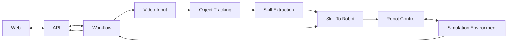

# Architecture 01 - Initial Minimal Challenge MVP

## 1. Purpose

This is the active architecture for the internship challenge MVP. It deliberately implements only the shortest complete path from a human demonstration video to a simulated robot manipulation result.

The project is designed for expansion without implementing future features prematurely.

The canonical project name is `skill-to-bot`. This document defines the active scope; `development-rules.md` defines mandatory implementation practice. Implementation and evidence are tracked in `dev_plans/build-01.md`.

## 2. Architecture rules

1. Use four runtime containers: `perception`, `simulation`, `orchestrator`, and `web`.
2. A pipeline feature is a module, not automatically a microservice.
3. Services communicate only through defined interfaces and contracts. A service must not import another service's internal source code.
4. One service failing must not terminate unrelated services.
5. The orchestrator reports unavailable dependencies as degraded service state.
6. Names are canonical: DFD name, directory name, primary module name, documentation name, and test name must remain directly traceable.
7. Do not implement Architecture Final features as placeholders unless required by Architecture 01.

## 3. Runtime containers

### 3.1 Perception

Container: `perception`

Responsibility: convert a human demonstration video into a compact skill representation.

Owned DFD processes:

- `Video Input`
- `Object Tracking`
- `Skill Extraction`

Directory mapping:

```text
services/perception/
├── Dockerfile
├── requirements.txt
├── requirements.lock
├── .env
├── .env.example
├── config.json
├── build-and-run.sh
├── run.sh
├── stop.sh
├── clean.sh
├── src/
│   ├── video_input/
│   │   └── video_input.py
│   ├── object_tracking/
│   │   └── object_tracking.py
│   └── skill_extraction/
│       └── skill_extraction.py
└── tests/
    ├── conftest.py
    ├── test_video_input.py
    ├── test_object_tracking.py
    └── test_skill_extraction.py
```

### 3.2 Simulation

Container: `simulation`

Responsibility: create the robot world, convert the extracted skill into robot targets, control the robot, and execute physics.

Owned DFD processes:

- `Simulation Environment`
- `Skill To Robot`
- `Robot Control`

Directory mapping:

```text
services/simulation/
├── Dockerfile
├── requirements.txt
├── requirements.lock
├── can_transfer.bddl
├── libero-config.yaml
├── .env
├── .env.example
├── config.json
├── build-and-run.sh
├── run.sh
├── stop.sh
├── clean.sh
├── src/
│   ├── simulation_environment/
│   │   └── simulation_environment.py
│   ├── skill_to_robot/
│   │   └── skill_to_robot.py
│   └── robot_control/
│       └── robot_control.py
└── tests/
    ├── conftest.py
    ├── test_simulation_environment.py
    ├── test_skill_to_robot.py
    └── test_robot_control.py
```

`Simulation Environment` owns LIBERO, robosuite, MuJoCo, the Panda robot, objects, scene reset, simulation stepping, and offscreen rendering.

`Skill To Robot` converts the embodiment-independent skill representation into robot-compatible end-effector and gripper targets.

`Robot Control` sends those targets to the robot controller and advances the simulation.

### 3.3 Orchestrator

Container: `orchestrator`

Responsibility: expose the application API, coordinate complete runs, monitor service availability, and stream state to the web application.

Owned DFD processes:

- `API`
- `Workflow`

Directory mapping:

```text
services/orchestrator/
├── Dockerfile
├── requirements.txt
├── requirements.lock
├── .env
├── .env.example
├── config.json
├── build-and-run.sh
├── run.sh
├── stop.sh
├── clean.sh
├── src/
│   ├── api/
│   │   └── api.py
│   └── workflow/
│       └── workflow.py
└── tests/
    ├── conftest.py
    ├── test_api.py
    └── test_workflow.py
```

The API should expose health and readiness information in addition to application operations. The workflow must tolerate a dependency being unavailable and return a clear degraded or failed run state rather than crashing the orchestrator.

### 3.4 Web

Container: `web`

Responsibility: provide the local browser development interface and form the basis of the later portfolio UI.

Owned DFD process:

- `Web`

Minimum UI capabilities:

- Select or upload a human demonstration.
- Select Live Camera, preview and map the object, record/stop, discard with No, or save with Yes before automatic pipeline execution.
- Start a run.
- Reset the simulation.
- Show the human demonstration.
- Show the simulated robot output.
- Show current run status.
- Confirm operator mapping with a yellow exclamation action before Run Demo; input changes clear confirmation.
- Show recorded run logs, skill JSON, and all tracked observations in three inline tabs.
- Show success or failure.
- Show unavailable service status without taking down the page.

Directory mapping:

```text
apps/web/
├── Dockerfile
├── .env
├── .env.example
├── config.json
├── build-and-run.sh
├── run.sh
├── stop.sh
├── clean.sh
├── package.json
├── package-lock.json
├── index.html
├── tsconfig.json
├── vite.config.ts
├── playwright.config.ts
├── nginx.conf
├── src/
│   ├── App.tsx
│   ├── LiveCamera.tsx
│   ├── RunStatus.tsx
│   ├── main.tsx
│   └── styles.css
└── tests/browser/
    ├── workspace.spec.ts
    └── camera.spec.ts
```

Use React, TypeScript, and Vite unless the active architecture is deliberately revised.

The package name is `@skill-to-bot/web`. Feature directories may be added during implementation when their owning UI responsibility is defined here; do not scaffold final-roadmap feature directories now.

## 4. Shared contracts

`contracts/` is not a runtime container.

For the MVP, keep the contract surface intentionally small.

```text
contracts/
└── skill.schema.json
```

`skill.schema.json` defines versioned manipulation intent passed from perception toward robot execution, rather than human joint-by-joint imitation.

The version 1.0 contract uses world-frame meters, three-coordinate position arrays, positive approach clearance, and ordered event times in seconds from the start of the source video. All top-level fields are required and unknown fields are rejected. Orientation is held upright by the simulation controller; arbitrary demonstrated rotation is outside MVP scope. Validate finite values, workspace limits, and strict event ordering at execution boundaries.

Minimum concepts should include:

- object identity or target reference
- object start pose when available
- destination or goal pose
- approach information
- grasp event
- transport information
- place event
- release event
- coordinate frame and calibration metadata

## 5. Canonical MVP data flow diagram



Ownership:

- `Video Input`, `Object Tracking`, `Skill Extraction` -> `perception`
- `Simulation Environment`, `Skill To Robot`, `Robot Control` -> `simulation`
- `API`, `Workflow` -> `orchestrator`
- `Web` -> `web`

## 6. Root repository structure

```text
skill-to-bot/
├── README.md
├── .github/workflows/build.yml
├── .gitignore
├── .gitattributes
├── .dockerignore
├── pyproject.toml
├── requirements-dev.txt
├── .env
├── .env.example
├── docker-compose.yml
├── build-and-run.sh
├── run.sh
├── stop.sh
├── clean.sh
├── scripts/
│   └── lifecycle.sh
├── dev_plans/
│   └── build-01.md
├── docs/
│   ├── README.md
│   └── architecture/
│       ├── README.md
│       ├── architecture-01.md
│       ├── architecture-final.md
│       └── development-rules.md
├── contracts/
│   └── skill.schema.json
├── services/
│   ├── perception/
│   ├── simulation/
│   └── orchestrator/
├── apps/
│   └── web/
├── tests/
│   ├── test_pipeline.py
│   ├── test_service_health.py
│   ├── test_lifecycle.py
│   └── fixtures/                 # Skill fixture and video regeneration script
└── data/
    ├── demonstrations/
    ├── live_demos/               # Ignored confirmed camera recordings
    ├── runs/
    └── fixtures/
```

All paths in this tree and the service mappings above are present. Supporting implementation files include per-service dependency manifests and locks, isolated test setup, the simulation BDDL task and LIBERO asset-path configuration, web build/test/proxy configuration, and `scripts/lifecycle.sh` for the common lifecycle implementation. `.gitkeep` files retain otherwise empty directories. Local `.env` files and `data/runs/` are ignored. Track actual verification status in the build checklist.

The four service boundaries use explicit interfaces coordinated by Workflow. Pipeline arrows describe logical data flow, not permission for perception to call simulation directly or import its source. The interfaces below define transfer, timeouts, and run state; `skill.schema.json` is the only shared schema file.

## 7. Testing hierarchy

Prioritize root end-to-end and Playwright browser workflows. Keep only focused service regressions for contract boundaries, manipulation safety, and failure handling. The pinned GitHub workflow builds the four containers and runs root and desktop/mobile tests on pushes and pull requests, retaining diagnostics on failure. No separate frontend component-test framework is used.

### Service tests

Each service owns tests for its internal modules. These tests must run without requiring the complete application whenever practical.

### Root pipeline tests

`tests/` at repository root owns cross-container behavior.

- `test_pipeline.py` validates the complete human-video-to-simulation path.
- `test_service_health.py` validates that unavailable services are reported correctly and do not cause cascading process failure.
- `tests/fixtures/` stores small deterministic test inputs used across services.

## 8. Lifecycle contract

Every runtime service must provide:

- `build-and-run.sh`
- `run.sh`
- `stop.sh`
- `clean.sh`
- `Dockerfile`
- `.env`
- `.env.example`
- `config.json`

The repository root provides the same lifecycle commands for the complete system.

`build-and-run.sh` is the reproducible clean-start command. It stops and removes the previous runtime instance, rebuilds, starts the service or system, waits for health, and reports success or failure. It may remove generated runtime state and caches, but it must never silently delete user-captured demonstrations or other explicitly persistent source data.

## 9. Configuration contract

- `.env` contains local environment and deployment values. Never commit it.
- `.env.example` documents required environment keys and is committed.
- `config.json` contains non-secret runtime behavior such as FPS, confidence thresholds, simulation timestep, camera options, and algorithm parameters.
- Docker Compose owns service names, networking, volumes, and deployment wiring.

## 10. Failure isolation

All backend services must expose consistent operational endpoints where applicable:

- `/health` - process is alive.
- `/ready` - service dependencies and initialization are ready for work.
- `/version` - build or application version.

A failed perception service must not kill simulation, orchestrator, or web. A failed simulation service must not kill perception, orchestrator, or web. The UI must communicate unavailable capabilities clearly.

## 11. MVP success condition

The MVP is complete when one personally collected human manipulation video can be processed into a skill representation and used to make a simulated Panda perform the corresponding pick, move, place, and release behavior under physics, with the human demonstration and simulation result visible in the browser.

## 12. Approved MVP transport

Use FastAPI HTTP REST/JSON interfaces and HTTPX clients between orchestrator, perception, and simulation. Browser commands use REST through orchestrator. WebSockets from orchestrator publish status snapshots; REST remains the source of truth after reconnecting. Recorded video artifacts use HTTP, not status-message payloads.

Browser-facing runs and asynchronous simulation execution return HTTP 202 and a run ID. Execution requests are keyed by that ID and are not blindly retried. The bounded internal perception call is synchronous inside the orchestrator's background task. Health reads may use bounded retries; processing and execution have bounded deadlines. Keep one active manipulation run and reject reset or conflicting execution while it is active. Do not add Kafka, ZeroMQ, a broker, or durable queue for this MVP. The simulation owns its controller and stepping loop entirely inside its process.

Dependency verification sources: [LIBERO](https://github.com/Lifelong-Robot-Learning/LIBERO), [robosuite source](https://github.com/ARISE-Initiative/robosuite), [Vite requirements](https://vite.dev/guide/), and [FastAPI WebSockets](https://fastapi.tiangolo.com/advanced/websockets/). Pin the LIBERO simulation-only source to `8f1084e3132a39270c3a13ebe37270a43ece2a01`; training packages and datasets are outside MVP scope.

## 13. MVP interfaces and calibration

Camera capture is an approved input path inside the existing Web/API ownership. Web uses [getUserMedia](https://developer.mozilla.org/en-US/docs/Web/API/MediaDevices/getUserMedia) and [MediaRecorder](https://developer.mozilla.org/en-US/docs/Web/API/MediaRecorder), with video only, a supported WebM/MP4 codec, explicit browser permission, and localhost/HTTPS. No microphone permission is requested. Camera tracks stop when leaving the camera view; capture timers and blob URLs are released on exit. Mapping inputs cannot change during recording or confirmation. Capture stops at 59 seconds to fit the 60-second server limit, with a 100 MB client/server cap.

`POST /live-demonstrations` receives only confirmed clips as multipart `file`, serializes conversion, and returns 201 after the saved input exists. Orchestrator uses pinned [imageio-ffmpeg](https://github.com/imageio/imageio-ffmpeg) 0.6.0 to normalize capture into seekable H.264 MP4 (25 FPS, at most 1280x720, no audio). Conversion has a 90-second deadline; unreadable, empty, oversized, or over-duration clips are rejected and temporary files removed. The UTC name is `live_demo_YYYYmmddTHHMMSSffffffZ_<8 hex>.mp4`, stored atomically in `data/live_demos`. This prefix is reserved for that directory. Existing library, preview, video, and run endpoints accept these names; perception reads the directory through a read-only mount. No schema or service boundary changes.

After Stop, Yes saves first and then submits the existing `/runs` request with the confirmed mapping. No discards the browser-only clip and restores idle capture; it makes no upload or run request. A failed save keeps the prompt for retry/discard. A failed run preserves the saved video in the library for inspection or another run. Browser tests use synthetic video streams rather than a physical camera, exercise permission/discard/failure handling on desktop/mobile, and pass an actual browser recording through conversion, perception, and physics. A real camera session still depends on the operator's permissions, framing, and demonstration quality.

Workflow records concise timestamped run logs in `run.json` and streams them with status snapshots. Logs describe processing, observed simulation phase changes, and completion or failure; they are not frame-level traces. The browser reads the skill from run state and observations through the existing artifact endpoint. All tracked frames are visible in a scrollable table; nothing requires a download. Older runs without recorded logs are labelled honestly. Uploaded UUID-named videos remain local and ignored by Git; supplied named demonstrations and the compact deterministic fixture remain repository inputs.

Verified build stack: Python 3.11, LIBERO source revision `8f1084e3132a39270c3a13ebe37270a43ece2a01`, robosuite 1.4.1, MuJoCo 2.3.7, NumPy 1.26.4, and CPU OSMesa rendering on Linux. FastAPI 0.115.12, HTTPX 0.28.1, and OpenCV contrib 4.10.0 provide service interfaces and CSRT tracking. The web build uses Node 22, React 19.1, TypeScript 5.8.3, and Vite 8.3.4. Exact direct and transitive Python versions are recorded in each service's `requirements.txt` and `requirements.lock`; web resolution is in `package-lock.json`. Training datasets, pretrained tracking models, and a GPU are not required.

LIBERO source and model assets are acquired at the pinned commit during the simulation image build, with LIBERO's MIT license retained in the image. robosuite and MuJoCo distribution licenses remain with installed packages. No copied third-party source or downloaded model cache is stored in this repository. `tests/fixtures/generate_video.py` regenerates the small can video fixture from the supplied source without modifying the original.

Browser-facing orchestrator operations: `GET /demonstrations`, `POST /demonstrations` (MP4 multipart upload, 100 MB and 60 seconds maximum), `GET /demonstrations/{name}` (video), `GET /demonstrations/{name}/preview` (first-frame JPEG), `POST /runs` (video name, calibration, request ID; returns 202), `GET /runs`, `GET /runs/{id}`, `GET /runs/{id}/preview` (actual simulation video poster), `GET /runs/{id}/artifacts/{name}`, `POST /reset`, `GET /services`, and `/ws` status snapshots. Web proxies these under `/api`. WebSockets require an approved browser origin and reconnect with REST refresh.

Perception accepts `POST /process` with a stored video name and operator calibration; it returns the validated skill, observations, and interpretation limitations. This bounded processing call is synchronous inside the orchestrator's background run, with a 180-second request deadline. Simulation accepts `POST /execute` with a 32-character hexadecimal run ID and validated skill, returns 202, and exposes `GET /jobs/{id}` plus `POST /reset`. Root upload storage is mounted read-only in perception; simulation writes only generated run artifacts. No video bytes travel in JSON or WebSocket status messages.

Run states are `running`, `completed`, and `failed`, with a separate processing/control phase and error context. Only one run executes at a time. Duplicate request IDs return the original run only if inputs match. Orchestrator persists run state and marks interrupted runs failed on restart; simulation job state is process-local. Restart and communication failure may leave physical execution outcome unknown, which must be reported honestly. No automatic retry of processing/execution commands is permitted; idempotent health reads are polled with bounded request deadlines.

The controlled-scene tracker is OpenCV CSRT initialized from an operator-selected normalized rectangle `[x, y, width, height]` in the first frame. A fixed front camera and visible, textured can are required. `operator_planar` calibration maps normalized horizontal displacement to robot world Y using an explicitly selected workspace span in meters. World X is held fixed; the simulated can starts on the configured table. Source lift evidence establishes manipulation intent and safe robot approach clearance. Neither physical camera depth nor a full metric 3D human trajectory is inferred.

Grasp/release times are motion-derived estimates: sustained departure from the initial pose, visible lift/transport, then stable placement. They do not prove human finger contact. Report this limitation with each skill and use a heuristic confidence score, not a claimed calibrated probability. Reject missing calibration, lost tracking, absent lift, insufficient transport, unstable placement, or unsupported depth/rotation assumptions.

Simulation uses the pinned LIBERO can asset and a minimal tabletop BDDL task. Skill poses describe the nominal world-frame intent anchor; the execution targets preserve the goal-minus-start displacement relative to the actual reset object pose. The Panda follows local OSC_POSE targets, preserving its initial downward gripper orientation, through physics with no object teleporting during execution. Success requires demonstrated gripper contact, at least 4 cm of physical lift, final position error no greater than 35 mm, no remaining gripper contact, and object speed no greater than 0.05 m/s after placement. Controller targets must converge within 8 mm, with bounded phase steps and a 240-second wall-clock deadline. Configuration files own these tolerances.
