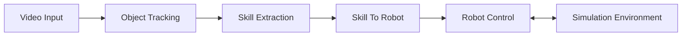
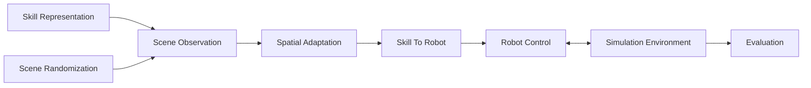
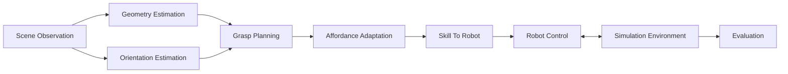
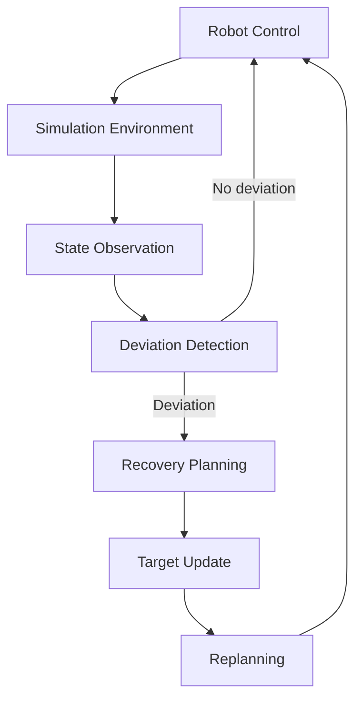
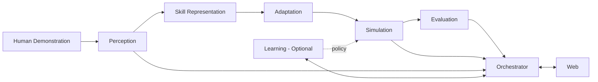

# Architecture Final - Envisioned System Roadmap

## 1. Purpose

This document describes the intended long-term architecture after the minimal challenge MVP. It is a roadmap, not an instruction to implement every component immediately.

Architecture 01 remains the active build target until a future capability is explicitly promoted.

The project name is `skill-to-bot`. Promote capabilities by updating the existing Architecture 01 and development rules in place. This roadmap's additional modules and schemas are not part of the current MVP.

## 2. Stable container boundaries

The system keeps four core services through deterministic Tiers 1 through 4:

1. `perception`
2. `simulation`
3. `orchestrator`
4. `web`

A fifth `learning` service is introduced only when training or learned policies create a genuine separate compute and deployment boundary, especially when GPU execution is required.

Do not split hand tracking, object tracking, inverse kinematics, control, rendering, or evaluation into network microservices merely because they are separate algorithms. Prefer strong modules inside the owning service.

## 3. Final repository structure

```text
skill-to-bot/
├── README.md
├── .github/workflows/build.yml
├── .gitignore
├── .gitattributes
├── .dockerignore
├── pyproject.toml
├── requirements-dev.txt
├── .env
├── .env.example
├── docker-compose.yml
├── build-and-run.sh
├── run.sh
├── stop.sh
├── clean.sh
├── scripts/
│   └── lifecycle.sh
├── dev_plans/
│   └── build-01.md
├── docs/
│   ├── README.md
│   └── architecture/
│       ├── README.md
│       ├── architecture-01.md
│       ├── architecture-final.md
│       └── development-rules.md
├── contracts/
│   ├── skill.schema.json
│   ├── observation.schema.json
│   ├── action.schema.json
│   ├── simulation-state.schema.json
│   ├── evaluation.schema.json
│   └── events.schema.json
├── services/
│   ├── perception/
│   │   ├── Dockerfile
│   │   ├── .env
│   │   ├── .env.example
│   │   ├── config.json
│   │   ├── build-and-run.sh
│   │   ├── run.sh
│   │   ├── stop.sh
│   │   ├── clean.sh
│   │   ├── src/
│   │   │   ├── video_input/
│   │   │   ├── hand_tracking/
│   │   │   ├── object_tracking/
│   │   │   ├── spatial_calibration/
│   │   │   ├── event_detection/
│   │   │   ├── skill_extraction/
│   │   │   └── skill_representation/
│   │   └── tests/
│   │
│   ├── simulation/
│   │   ├── Dockerfile
│   │   ├── .env
│   │   ├── .env.example
│   │   ├── config.json
│   │   ├── build-and-run.sh
│   │   ├── run.sh
│   │   ├── stop.sh
│   │   ├── clean.sh
│   │   ├── src/
│   │   │   ├── simulation_environment/
│   │   │   ├── scene_observation/
│   │   │   ├── scene_randomization/
│   │   │   ├── spatial_adaptation/
│   │   │   ├── geometry_estimation/
│   │   │   ├── orientation_estimation/
│   │   │   ├── grasp_planning/
│   │   │   ├── affordance_adaptation/
│   │   │   ├── skill_to_robot/
│   │   │   ├── robot_control/
│   │   │   ├── state_observation/
│   │   │   ├── deviation_detection/
│   │   │   ├── recovery_planning/
│   │   │   ├── target_update/
│   │   │   ├── replanning/
│   │   │   └── evaluation/
│   │   └── tests/
│   │
│   ├── orchestrator/
│   │   ├── Dockerfile
│   │   ├── .env
│   │   ├── .env.example
│   │   ├── config.json
│   │   ├── build-and-run.sh
│   │   ├── run.sh
│   │   ├── stop.sh
│   │   ├── clean.sh
│   │   ├── src/
│   │   │   ├── api/
│   │   │   ├── workflow/
│   │   │   ├── service_health/
│   │   │   ├── run_management/
│   │   │   ├── streaming/
│   │   │   └── clients/
│   │   └── tests/
│   │
│   └── learning/                 # Optional Tier 5+
│       ├── Dockerfile
│       ├── .env
│       ├── .env.example
│       ├── config.json
│       ├── build-and-run.sh
│       ├── run.sh
│       ├── stop.sh
│       ├── clean.sh
│       ├── src/
│       │   ├── datasets/
│       │   ├── behavior_cloning/
│       │   ├── policy_inference/
│       │   └── evaluation/
│       └── tests/
│
├── apps/
│   └── web/
│       ├── Dockerfile
│       ├── .env
│       ├── .env.example
│       ├── config.json
│       ├── build-and-run.sh
│       ├── run.sh
│       ├── stop.sh
│       ├── clean.sh
│       ├── package.json
│       ├── src/
│       │   ├── features/
│       │   │   ├── human_demo/
│       │   │   ├── skill_viewer/
│       │   │   ├── simulation_viewer/
│       │   │   ├── controls/
│       │   │   ├── results/
│       │   │   └── service_status/
│       │   └── shared/
│       └── tests/
│
├── tests/
│   ├── test_pipeline.py
│   ├── test_service_health.py
│   ├── test_lifecycle.py
│   ├── test_generalization.py
│   ├── test_recovery.py
│   └── fixtures/
│
└── data/
    ├── demonstrations/
    ├── runs/
    ├── fixtures/
    └── exports/
```

## 4. Tier 1 - Deterministic skill transfer

Goal: one human demonstration drives one simulated manipulation.



Primary result: human pick, move, place, release is represented as manipulation intent and executed by the Panda without copying every human joint.

## 5. Tier 2 - Spatial generalization

Adds:

- `Scene Observation`
- `Scene Randomization`
- `Spatial Adaptation`



Goal: reuse the same skill when the object starts in different feasible locations.

## 6. Tier 3 - Geometry and orientation generalization

Adds:

- `Geometry Estimation`
- `Orientation Estimation`
- `Grasp Planning`
- `Affordance Adaptation`



Goal: adapt the manipulation to object rotation and related geometry while choosing a robot-feasible grasp.

## 7. Tier 4 - Closed-loop adaptation and recovery

Adds:

- `State Observation`
- `Deviation Detection`
- `Recovery Planning`
- `Target Update`
- `Replanning`



Goal: preserve the original manipulation objective after disturbances, changed object state, or failed grasp attempts.

## 8. Tier 5 - Optional learning service

Introduce `learning` only when a learned policy is justified by measurable benefit.

Initial learning candidate: behavior cloning from multiple demonstrations.

Possible inputs:

- object pose
- goal pose
- robot end-effector state
- gripper state
- manipulation phase

Possible output:

- next robot action or target

The learning service is the natural first service to move to the Ubuntu RTX 4060 machine when GPU acceleration becomes useful. The rest of the architecture should remain capable of running on the Windows Docker development machine.

## 9. Final system data flow

This diagram groups future capabilities conceptually. `Skill Representation`, `Adaptation`, and `Evaluation` are data or modules inside the owning services, not additional runtime containers. Workflow coordinates service calls; logical arrows do not establish new network interfaces.



## 10. Service communication and resilience

The orchestrator is the application coordination and fault-containment layer.

Expected degraded behavior:

- Perception unavailable: web, orchestrator, and simulation remain available. New video processing is disabled.
- Simulation unavailable: perception can still process demonstrations. Robot execution is disabled.
- Learning unavailable: deterministic Tiers 1 through 4 continue normally.
- Web unavailable: backend services continue independently.

Use explicit timeouts and bounded retries. Do not create infinite retry loops. A dependency failure must become a visible state, not a cascading crash.

## 11. Rendering and development UI

MuJoCo remains native inside the simulation container and renders offscreen. The browser is the development viewer and control surface, not the physics engine.

Local path:

```text
Windows Browser
    -> localhost
    -> Web / Orchestrator
    -> Simulation container
    -> LIBERO
    -> robosuite
    -> MuJoCo
```

The UI begins as the local development GUI and evolves into the portfolio interface. Recorded demonstration and simulation video should remain available as a lightweight portfolio fallback even if interactive simulation cannot be hosted publicly.

## 12. Non-goals unless explicitly promoted

Do not add these simply because they are common infrastructure patterns:

- Kubernetes
- Redis
- message brokers
- a database
- object storage
- separate tracking microservices
- separate IK or controller microservices
- cloud GPU infrastructure
- VLA models
- world models
- reinforcement learning

Each addition must solve a demonstrated requirement.
